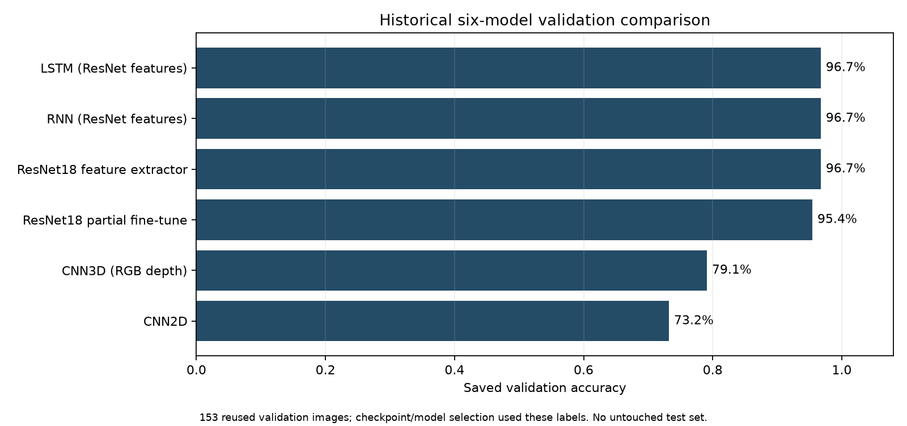

# Six-model vision comparison: ants and bees

An educational PyTorch comparison of scratch convolutional networks, ImageNet ResNet18 transfer learning, and recurrent heads over frozen visual features.

The saved experiment used **244 training images and 153 validation images**. Three models reached **148/153 correct validation predictions (96.73%)**. The validation folder selected checkpoints and informed later experiment changes, so these scores **are not independent test estimates**.

## Models and historical results

| Model | Approach | Saved validation accuracy | Macro F1 | Selected epoch |
|---|---|---:|---:|---:|
| ResNet18 feature extractor | Frozen ImageNet encoder; trained MLP head | 96.73% | 0.9671 | 10 |
| RNN on ResNet features | Frozen encoder; bidirectional RNN over feature rows | 96.73% | 0.9671 | 9 |
| LSTM on ResNet features | Frozen encoder; bidirectional LSTM over feature rows | 96.73% | 0.9670 | 2 |
| ResNet18 partial fine-tune | Train final residual block and new head | 95.42% | 0.9540 | 2 |
| CNN3D, RGB depth | Scratch 3D convolutions treating RGB as depth | 79.08% | 0.7868 | 11 |
| CNN2D | Scratch residual convolutional baseline | 73.20% | 0.7318 | 25 |

These numbers are preserved from the original `model_results.json`, not newly trained results. Histories, per-class precision/recall/F1 and confusion matrices are in [results/model_results.json](results/model_results.json). The verification script recomputes accuracy and macro metrics from each confusion matrix. A tied aggregate score does not mean identical predictions.



## Method

- Training-only crop, horizontal flip, rotation and light color jitter; deterministic resize/center crop at validation.
- Scratch models use 128 × 128 images. ResNet-based models use 224 × 224 images and ImageNet normalization.
- AdamW, cosine learning-rate decay and cross-entropy with 0.03 label smoothing; individual schedules and seeds are retained in the historical JSON.
- Best checkpoint: highest validation accuracy, then lowest validation loss for a tie.
- Recurrent models average ResNet feature columns and read the remaining spatial rows as a sequence. They are hybrid vision/sequence models, not plain recurrent networks on raw pixels.
- Frozen encoders keep batch-normalization statistics in evaluation mode. The reusable recurrent class now enforces this for direct `.train()` callers too.

The 3D model has a three-channel RGB depth axis; this is not volumetric imaging or video analysis.

## Setup and quick checks

Use Python 3.12 in a virtual environment. Install compatible PyTorch/TorchVision builds for your platform, then the other dependencies:

```bash
python -m venv .venv
# Activate .venv using your shell's normal command.
python -m pip install -r requirements.txt
python scripts/summarize_results.py
python -m unittest discover -s tests -v
```

`summarize_results.py` uses only Python's standard library unless `--plot` is requested. Architecture tests use synthetic tensors/images and `weights=None`; they require PyTorch/TorchVision but do not download pretrained weights or access dataset images. See [validation details](docs/VALIDATION.md) for what was actually executed during preparation.

## Dataset acquisition and optional training

No dataset photographs, embedded sample-photo outputs or model checkpoints are distributed here. [DATA_SOURCES.md](DATA_SOURCES.md) links the official PyTorch acquisition route and explains the unverified image redistribution rights.

After reviewing the applicable terms, acquire the archive from the official tutorial and extract it to a location containing:

```text
hymenoptera_data/
  train/ants/  train/bees/
  val/ants/    val/bees/
```

Run an intentional new experiment:

```bash
python scripts/train_models.py --data-dir /path/to/hymenoptera_data --models "ResNet18 feature extractor" --weights imagenet
```

`--weights imagenet` may download official ResNet18 weights. `--weights none --epochs 1` is an implementation smoke experiment, not a reproduction of pretrained results. New runs go to ignored `results/runs/<timestamp>/`; historical results are never overwritten.

Alternatively, set the `VISION_DATA_DIR` environment variable and open [the sanitized notebook](notebooks/six_model_comparison.ipynb). Running the full notebook trains all six models and can be expensive. It also displays local dataset examples; review new outputs before sharing.

## Interpretation and limitations

1. There is no untouched test set. Reusing validation for epoch selection and iterative design can produce optimistic scores.
2. The dataset is small. A one-image change is about 0.65 percentage points on this validation set.
3. Different resolutions, schedules, seeds and pretrained features prevent a controlled claim that one architecture alone caused an improvement. The RNN/LSTM runs also use different seeds.
4. Historical results have not been reproduced by GPU retraining during repository preparation. Deterministic settings in the reusable new-run entry point improve repeatability but do not promise bit-identical historical scores.
5. Duplicate-image checks can detect byte-identical files, but cannot rule out near-duplicates or shared source subjects.
6. No real-world deployment, production accuracy, novel architecture or independent dataset ownership is claimed.

A useful next experiment would freeze the protocol before collecting an independent test set or use nested/group-aware evaluation. It should preserve negative results rather than tune repeatedly against the same final holdout.

## Files and credits

- `src/vision_comparison.py`: extracted model definitions and reusable data/training utilities.
- `notebooks/`: output-cleared coursework experiment with portable dataset/output paths.
- `scripts/`: result verification, optional training and dataset integrity checks.
- `tests/`: offline architecture, transform and frozen-state checks.
- `results/`: compact historical numerical evidence and metrics-only chart.

Coursework supplied by **Ginno D. Arostique Jr.**, BS Computer Science (AI), West Visayas State University. The models build on established PyTorch/TorchVision architectures and transfer-learning patterns; see [ATTRIBUTION.md](ATTRIBUTION.md). Publication preparation refactored the supplied experiment and added checks; this does not establish that every original line was individually authored or that the architectures are original research.

New project contributions use the [MIT license](LICENSE). Applicable tutorial-derived portions retain the upstream BSD terms in [THIRD_PARTY_NOTICES.md](THIRD_PARTY_NOTICES.md); neither license grants rights to dataset photos or pretrained weights.
